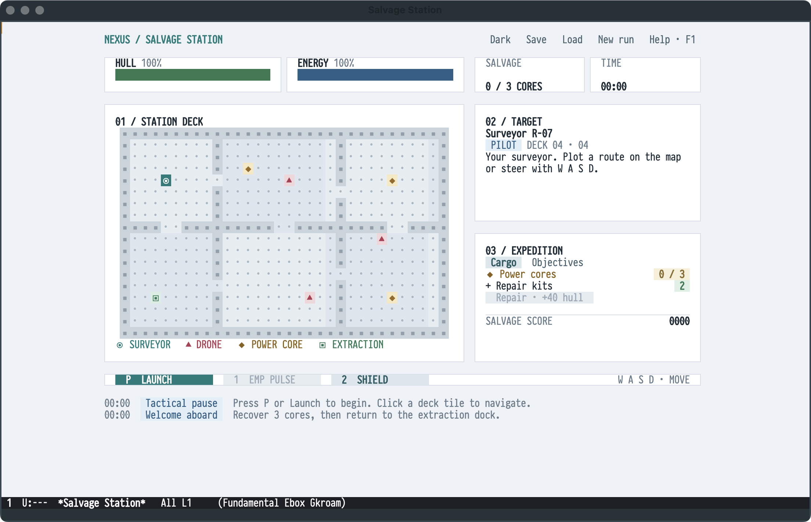
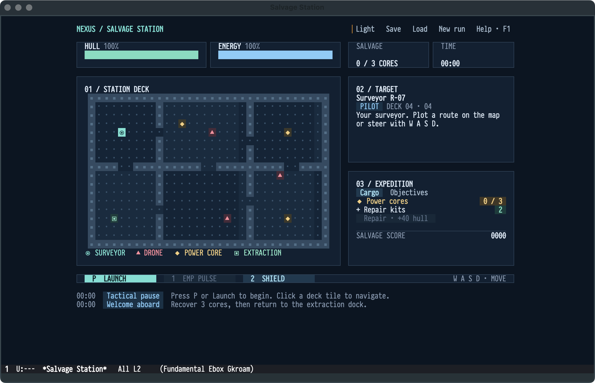

# Salvage Station

A real-time exploration and extraction game with a native ETAF interface and a
headless [Godot](https://godotengine.org) simulation, built as an independent
[GameKit](https://github.com/emacs-taf/etaf-gamekit) application. Recover
three power cores and return to the extraction dock; avoid or disable security
drones, manage hull and energy, and use repair kits along the way.

Godot owns movement, collision, pathfinding, drones, energy, damage, score and
victory or defeat. This application owns selection, tabs, dialogs and all
presentation; GameKit supplies only the shared game instance and backend
connection.





## Capabilities

- One headless simulation with a live HUD for hull, energy, cores, score and
  elapsed time, and a map for plotting routes.
- Object selection, an expedition panel, EMP and shield actions, and a
  tactical pause that the game starts in.
- Light daylight and dark deep-space palettes that keep the expedition
  running across a switch.
- Explicit local snapshots through Save and Load; closing makes no implicit
  save.

## Prerequisites

| Requirement | Why | Check |
| --- | --- | --- |
| Emacs 29.1 or newer | the ETAF runtime | `emacs --version` |
| `ecss`, `ebox`, `etaf`, `etaf-ui` | the framework and catalog components | every root entry is on `load-path` |
| `etaf-gamekit` and its Godot runtime | simulation host, game instance and state publication | `make -C etaf-gamekit engine` |
| Python 3.9 or newer | GameKit's Godot setup script | `python3 --version` |

## Installation

```sh
git clone https://github.com/emacs-taf/ecss.git
git clone https://github.com/emacs-taf/ebox.git
git clone https://github.com/emacs-taf/etaf.git
git clone https://github.com/emacs-taf/etaf-ui.git
git clone https://github.com/emacs-taf/etaf-gamekit.git
git clone https://github.com/emacs-taf/etaf-salvage.git
make -C etaf-gamekit engine
```

Add every provider root and this repository to `load-path`:

```elisp
(add-to-list 'load-path "/path/to/ecss")
(add-to-list 'load-path "/path/to/ebox")
(add-to-list 'load-path "/path/to/etaf")
(add-to-list 'load-path "/path/to/etaf-ui")
(add-to-list 'load-path "/path/to/etaf-gamekit")
(add-to-list 'load-path "/path/to/etaf-salvage")
(require 'etaf-salvage)

(global-set-key (kbd "C-c v") #'etaf-salvage-open)
```

`M-x etaf-salvage-open` starts an independent instance and fits the view to its
window. The Godot project lives in `native/godot/` and is resolved relative to
the application's own entry file.

## Keys

| Input | Action |
| --- | --- |
| `P` or Launch / Pause | Start or stop the simulation |
| `W A S D` | Extend the navigation destination by one cardinal tile |
| Click deck | Plot a route around bulkheads |
| Click an object | Inspect it; use Plot route to target to navigate there |
| `1` or EMP | Disable drones within five tiles; costs 20 energy |
| `2` or Shield | Protect the hull for five seconds; costs 25 energy |
| Cargo → Repair | Use one of two kits to restore up to 40 hull |
| `?`, `F1` or Help | Open searchable controls and flight notes in the current buffer |
| `T` or Light–Dark | Switch between the light daylight and dark deep-space palettes |
| Save / Load | Choose an explicit local snapshot path |

`etaf-salvage-appearance` selects the initial palette: `auto`, the default,
follows the frame's background mode.  The status line and the log panel report
events; the minimum canvas is 76 character columns by 30 rows, and narrower
windows reflow or expose the panels.

## Checks

```sh
make check   # structure, compilation, API and real-backend behavior scenarios
```

GUI scenarios and interaction latency measurements are separate acceptance
surfaces; the [manual](docs/manual.md) describes them.

## Documentation

- [Salvage Station manual](docs/manual.md) — gameplay, window adaptation and
  GUI acceptance.
- [Package entry](etaf-salvage.el) — the supported API inventory.
- [GameKit](https://github.com/emacs-taf/etaf-gamekit) — the shared game
  framework, its adapters and backend installation.

## License

GPL-3.0-or-later; see [LICENSE](LICENSE).
